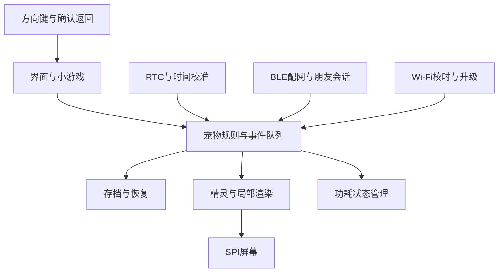

# MyPat ESP32-C3 随身宠物机可行性设计

## 可行性结论

版本：v0.1.0。编制与版本日期：2026年10月29日（北京时间）。状态：方案评审稿；尚未开发固件或验证实物。项目暂名 MyPat，代码仓库沿用 PetFeeding。

面向7岁儿童，制作一台带彩色屏幕、方向键和确认键的随身电子宠物机。首次启用获得随机宠物，可喂饭、玩耍、清理便便、睡觉，按照真实时间逐月成长；两台设备可在附近互相发现并互动，同时支持家长通过 BLE 配置 Wi-Fi。

**总体可行，ESP32-C3 足以承担小尺寸二维像素动画、规则驱动的养成和短时无线互动。** 建议首版以离线养成为核心，选择240×240 SPI彩屏、至少8 MB Flash、可靠时钟与可充电电池。它不需要云端AI或持续联网。

ESP32-C3采用最高160 MHz的单核RISC-V，片上SRAM为400 KB，其中部分供缓存使用，支持2.4 GHz Wi-Fi与Bluetooth LE；这些资源需要共同承担系统、画面和通信，不能全部分配给动画。[乐鑫芯片资料](https://documentation.espressif.com/esp32-c3_datasheet_en.html)

| 用户需求 | 设计落点 | 主要条件 |
| --- | --- | --- |
| 开机随机得到自己的宠物 | 首次生成并永久保存身份与外观种子 | 重启、升级不得重新抽取 |
| 吃饭、玩耍、便便、睡觉 | 本地状态机与短小游戏 | 无网也完整运行 |
| 大多数时间喜欢睡觉 | 闲置自动入睡，夜间安静 | 游戏中的睡眠与芯片休眠分别管理 |
| 睡得越久长得越快 | 有上限的睡眠成长加成 | 不允许一天跨越多个成长阶段 |
| 现实中每月长大一点 | 真实年龄加成长积分双门槛 | 断电后要有可靠的时间恢复途径 |
| 两台设备互相发现互动 | 主动开启BLE结伴，双方确认 | 深度休眠时无法发现对方 |
| BLE配网与Wi-Fi联网 | 家长配网入口，联网校时与升级 | 手机端配网工具也是开发范围 |

**建议立项范围：** 先验证两台样机，完成“拿到即养、睡眠成长、重启不丢宠、近场合玩、家长配网”。屏幕尺寸、续航和价格尚未确定，后文的数值均为设计初值或估算，不是实测承诺。

## 产品与玩法

### 第一次拿到设备

1. 开机显示蛋与简短欢迎动画，30至60秒内完成孵化，不要求先联网或注册账号。
2. 使用硬件随机源生成128位宠物ID和遗传种子；生成前按所选SDK要求初始化随机源，不用MAC地址或固定启动时间代替随机数。
3. 从预制素材中组合物种、配色、耳朵、尾巴、花纹和性格，先持久化再显示孵化结果。
4. 孩子选择一个预设名字，或通过家长端取名；短教程依次完成喂饭、抚摸、送睡觉。
5. 显示生日、出生形象和第一张纪念卡，回到宠物房间。

“自己的宠物”指身份独立、成长经历不同，不能承诺外观绝不重复。建议首版3种基础物种、4种配色、3种花纹、3种装饰，理论有108种组合，实际数量取决于素材兼容表。遗传种子决定稳定特征，成长记录决定后续形态；重刷普通固件不应清除存档，重新领养必须由家长明确执行。

### 形象与操作

采用数码宝贝式的“小怪兽、阶段成长、分支进化”表达，可有小龙、森林兽、星星兽等外形，性格活泼或温柔不按性别固定。正式发布素材建议制作原创角色，若采用现成角色则单独确认素材使用条件。首版不设计强对抗或失败惩罚。

推荐上下左右加确认、返回共6键。主页显示大宠物、当前心情和最多一条需求提示；左右切换食物、游戏、清洁、睡眠、朋友和相册，上下选择，确认执行，返回退出。图标为主、短中文为辅，首次操作提供动画提示。家长设置使用组合长按及单独确认，清档增加确认步骤；组合按键不视为安全认证。

宠物动画建议覆盖待机、走动、高兴、进食、游戏、便便、困倦、睡眠、受惊、成长10类状态。64×64或96×96像素精灵，常态6至12帧每秒，界面局部刷新目标15至20帧每秒。

### 日常照顾与短游戏

| 玩法 | 孩子的操作 | 宠物的反馈与持续变化 |
| --- | --- | --- |
| 喂饭 | 选择主食、蔬果或零食 | 进食动画与喜好反馈；每天前几次有效照顾影响亲密度，反复喂食不刷成长 |
| 玩球 | 左右接球，30至60秒一局 | 不同物种反应不同；获得装饰材料 |
| 记忆配对 | 用方向键找相同图案 | 低难度起步，失败可重试 |
| 抚摸与聊天卡 | 确认键选择问候 | 表情、短句、偶尔送纪念贴纸，无需语音识别 |
| 清理便便 | 选择扫帚并确认 | 清洁动画；便便最多保留3个，避免长期离线积累大量负担 |
| 睡觉 | 选择小床或等待闲置 | 打哈欠、盖被子，睡眠积累成长；醒来可能带回梦境纪念物 |

建议每天2至4次、每次1至3分钟即可获得完整照顾体验，不设必须上线的连续签到。小游戏成绩影响小奖励与性格倾向，不决定宠物能否长大。每天最多形成一条有意义的日记，长期通过相册、喜好、成长和分支变化维持可玩性。

### 情绪与需求规则

内部保留饱食、心情、精力、清洁和亲密度等指标，范围0至100；孩子主要看到表情和“想吃饭”“想玩球”“困了”等提示。

初始调参方案：清醒时饱食每小时减少约4，睡眠时每小时减少约1；心情清醒时每小时减少约2，睡眠不因无人操作而持续下降；玩耍消耗精力，睡眠恢复精力。每2至3次有效进食可触发一次便便，同一进食事件仅结算一次。数值触底进入安静等待照顾状态。

建议不设计死亡、离家、不可逆退化或夜间催促。孩子数日没照顾，回来可以清洁、喂饭并恢复状态。可爱与牵挂来自反馈和共同经历，避免以负罪感维持使用。

## 成长与时间

### 多数时间睡觉仍然有事可玩

宠物默认偏爱睡觉，目标每天累计约16小时；例如夜间10小时加白天几段午睡。未操作2分钟开始犯困，5分钟进入宠物睡眠；实际阈值在儿童试用后调整。主人主动玩耍可唤醒，夜间唤醒只显示安静界面，短暂回应后继续休息。按键先点亮屏幕，选择互动才结束宠物睡眠，单纯查看不会中断成长。

睡眠期间可以查看呼吸动画、梦泡泡、相册和成长进度。睡眠不要求亮屏，也不要求CPU持续运行，关屏后按时间戳计算。宠物不因睡眠期间的饥饿或便便被强制唤醒。

“宠物睡眠”是游戏状态，“芯片深度休眠”是节电状态。宠物睡着时机器可以短暂醒来显示画面；机器休眠时仍通过时钟记录宠物睡了多久。

### 真实年龄与成长积分

建议区分真实年龄、成长积分与形态阶段。出生即为幼体，孵化是开机仪式；首日和首周通过表情、喜好、配饰和新动作提供变化，明显的体型或形态变化约每月一次。

首版定义一个成长月为30×24小时，避免自然月长度不同。成长积分按以下初值计算：

- 每经过24小时可靠真实时间，获得0.5成长日。
- 每累计16小时有效睡眠，再获得0.5成长日；每个固定24小时成长窗口最多计16小时睡眠。
- 因此每天最多1成长日，不睡眠时约0.5成长日；睡眠8小时约0.75，睡眠16小时及以上约1。
- 每累计30成长日且距离上次成长至少经过30个真实日，进入下一阶段。
- 玩耍、喂食与朋友互动影响外观分支、亲密度和收藏，不增加上述每日成长上限。

例：规律睡16小时，约第30、60、90天依次成长；每天只睡8小时，首次约40天成长；完全不睡，首次约60天成长。超过16小时的睡眠可以恢复精力，但不继续提高当天成长速度。阶段有最短间隔，补算出多个历史阶段时，按实际满足条件的历史时间排列，主人回来看到连续纪念回放。

这些规则满足“睡得越久长得越快”，同时保留真实月份的意义。若希望不论睡眠多少都严格每月变大，应改为年龄决定体型、睡眠决定进化分支；该模式作为可选规则，不与首版积分模式混用。

### 形态与长期内容

| 阶段 | 最早真实时间 | 形象和玩法变化 |
| --- | --- | --- |
| 幼体 | 首次孵化 | 基础动作、喂养和玩球 |
| 成长期一 | 约30天 | 体型增大、新表情与配饰位 |
| 成长期二 | 约60天 | 耳尾或花纹变化，新小游戏表现 |
| 成长期三 | 约90天 | 根据长期照顾偏好出现分支 |
| 成熟期 | 约120天 | 保留全部玩法，开放长期收藏与纪念 |

成熟后继续陪伴，不自动死亡或重置。首版3条物种线各5个主形态，约15套主体，再以调色和配饰组合扩展；制作量须按状态与帧数核算，不能把108种组合当作108套完整动画。

### 计时可靠性与离线补算

芯片内RTC可在睡眠时计时，但上电复位会使其计时基准丢失；内部RC时钟也会受温度影响。因此仅靠保存“最后操作时间”无法知道完全断电了多久。[乐鑫系统时间说明](https://docs.espressif.com/projects/esp-idf/en/stable/esp32c3/api-reference/system/system_time.html)

推荐增加低功耗外部RTC及备用供电，具体器件待封装、精度与成本比较后确定；它用于主电池耗尽或关闭主电源期间保持日历。备用电源封在外壳内，设计时检查失效标志与供电切换。若不增加独立RTC，正常深睡仍可成长，但断电后需家长手机校时或联网校时，时间未知期间不能准确补算。

首次烧录时由工装设置RTC；若首次启用时RTC时间无效，仍允许孵化和玩耍，由家长通过按键设置日期时间或手机校时后开始可靠计日，不能把未初始化的日期当作真实生日。

采用UTC时间戳保存出生、最后结算、入睡和阶段事件；本地时区仅影响作息显示。每个宠物以出生时刻划定固定24小时成长窗口，更改时区不刷新奖励。运行中以单调时钟记录时长，校准墙钟时不重复计算过去区间。

重启后以最后快照补算到当前可靠时间，按睡眠区间与窗口求交累计，不逐秒模拟。数月离线也要结算全部有效成长时间；便便、通知、相册摘要限制数量。长时间离线默认在闲置阈值后睡眠，需求值有下限，不追溯制造惩罚。

检测时钟回退、RTC失效或异常大幅快进时保留宠物，不减少已得成长、不重复领奖，暂缓可疑时段成长并提示家长校时。网络校时本身不等于防篡改；首版以家庭离线体验为目标，不能承诺抵抗物理改时或刷机作弊。

## 硬件与功耗

### 推荐样机配置

| 部件 | 建议规格 | 理由与待验证项 |
| --- | --- | --- |
| 主控 | ESP32-C3模块，8 MB Flash优先 | 减少射频设计工作；采购时核对具体模块料号和Flash容量 |
| 显示 | 1.3至1.54英寸、240×240、SPI TFT，ST7789类控制器 | 彩色像素宠物清晰；控制器、偏移和背光接口以实际屏幕为准 |
| 按键 | 方向4键、确认、返回 | 低文字依赖；至少保留一个可深睡唤醒的按键 |
| 存储 | Flash中分区保存程序、素材、存档 | 首版不依赖TF卡，不把外部PSRAM作为前提 |
| 计时 | 外部低功耗RTC及不可触及的备用电源 | 维持真实月份与主电池断电后的计时 |
| 供电 | 500至800 mAh单节可充电电池、USB-C充电 | 容量结合外壳与续航实测定型 |
| 电源管理 | 充电、保护、温度检测、稳压与背光开关 | 评估边充边用的电源路径、峰值电流和整机漏电 |
| 声音 | 可静音蜂鸣器，可选小扬声器 | 首版短音效即可，不需语音 |
| 电量 | 分压ADC或独立电量计 | 验证负载下电压、分压漏电和低电保存阈值 |
| 外壳 | 圆角、屏幕保护、螺丝固定 | 电池和小零件不可被孩子轻易拆出；携带优先短挂带 |

GPIO要逐项分配：屏幕SPI及控制、6键、RTC I2C、蜂鸣器、电量与充电检测、下载调试。不同模块实际可用引脚数量不同，必须避开Flash占用与启动绑带冲突。若不足，优先按键矩阵或I2C扩展；唤醒键单独连接经核对支持深睡唤醒的GPIO。定板前输出引脚表，不能仅按芯片“总GPIO数量”下结论。

### 显示与内存预算

RGB565的240×240全帧占115,200字节，即112.5 KiB；双全帧需225 KiB。建议按20行分块双缓冲，仅约18.75 KiB；精灵从Flash按需读取，避免把所有动画解压到RAM。96×96的RGB565单帧约18 KiB，使用索引色或压缩素材可减少存储，解码开销需实测。

初始RAM预算：显示缓冲约19 KiB，素材与字体工作区20至40 KiB，宠物状态及事件10至20 KiB，其余留给ESP-IDF、任务栈、BLE、Wi-Fi及TLS。上述不是总占用保证；以链接映射、最低剩余堆和最大连续可分配块验收，同时测试无线模式和动画。建议最重模式仍保留至少40 KiB内部空闲堆，并验证TLS峰值；不足时先串行化联网与互动、缩减缓冲和字体。

8 MB Flash初步预算：两份OTA应用各2 MB、素材约2 MB、系统与存档预留约0.5 MB，其余留作增长。正式分区需按实际应用体积和对齐要求生成；若带中文字体后单份超过预算，调整容量或素材规模，不挤掉存档恢复区。

### 功耗模式

| 整机模式 | 屏幕与无线策略 | 使用情境 |
| --- | --- | --- |
| 玩耍 | 亮屏与局部动画；按需BLE | 短时照顾与小游戏 |
| 查看 | 低亮度，低帧率 | 看睡姿、相册与状态 |
| 结伴 | BLE广播和扫描，最长约60秒发现窗口 | 双方主动打开朋友功能 |
| 联网 | 短时Wi-Fi校时或下载 | 家长操作或充电时 |
| 长待机 | 关闭背光、停无线、深度休眠 | 宠物多数睡眠时段 |

ESP-IDF说明深度休眠不会保持Wi-Fi或BLE连接；需要保持连接时应采用相应无线省电和自动Light-sleep配置，不能把它等同于深睡。[乐鑫睡眠模式](https://docs.espressif.com/projects/esp-idf/en/stable/esp32c3/api-reference/system/sleep_modes.html)

续航情景估算以电池侧电流为口径：假设600 mAh电池可用80%，每天亮屏玩耍20分钟平均80 mA、结伴5分钟平均70 mA、联网2分钟平均150 mA、其余时间平均0.1 mA，则日耗电约40 mAh，约12天。若亮屏增加至60分钟，同样口径约需93 mAh每天，约5天。电流均为假设，须实测背光、稳压、RTC、充电芯片和唤醒损耗；不能用芯片深睡电流代替整机电流。

首版目标为典型使用至少7天，整机深睡电流争取低于200 µA；开发板上的常亮LED、USB串口芯片可能使目标无法达到。持续亮屏或持续扫描的续航需单独定义，不能沿用上述估算。

## 固件与数据

### 软件架构

使用VS Code配合ESP-IDF官方工具链开发；ESP32-C3属于RISC-V，不套用ARM EIDE工程。PoC通过后锁定ESP-IDF稳定版本、组件版本与依赖锁文件。显示采用轻量精灵渲染，或在内存预算内裁剪LVGL；首版先验证轻量方案。

宠物引擎是唯一可写宠物状态的模块；按键、无线和小游戏投递事件，由引擎验证条件后更新。网络回调不直接修改存档，也不阻塞绘图。把宠物规则与硬件驱动分离，支持PC端模拟时间和规则单元测试。

推荐按职责划分为board、pet、ui、games、storage、time、connectivity、power等模块；这是后续固件目录规划，当前不创建空实现。内部使用统一消息结构和有界队列，限制无线包长度、好友数、日志长度和资源索引。

### 存档与恢复

核心字段包括schema_version、pet_id、基因种子、外观版本、出生时间、真实年龄、成长积分、阶段、需求值、入睡时间、最后结算时间、亲密度、收藏与朋友记录。随机事件保存种子或结果，防止重启反复抽奖。

建议使用独立NVS分区保存两份小型快照，附序号、版本和校验；先写入新快照并提交成功，再将其视为最新。启动时选择最新且完整的一份；多键更新不假定天然跨键原子。素材放单独只读分区。NVS适合小型键值数据，大体积资源应另存。[乐鑫NVS说明](https://docs.espressif.com/projects/esp-idf/en/stable/esp32c3/api-reference/storage/nvs_flash.html)

喂养、进化、礼物、进入睡眠及升级前立即落盘；普通数值合并到周期性快照，不逐帧写Flash。进入深睡先结算再保存。低电时停止联网、保存并休眠，异常断电允许普通短期心情变化回退到最后快照，但已确认的孵化与礼物不得重复。损坏时优先恢复另一份，禁止自动生成新宠覆盖原档。

升级包含存档迁移与回退兼容策略。新固件通过自检前不执行不可逆存档迁移，可采用保留旧快照加新版本副本；若迁移失败，保留证据并回退。

### 发布交付

每次固件提交更新版本号和构建日期，同步日志、资源版本和兼容版本。交付包含bootloader、分区表、应用、素材、初始数据和合并烧录镜像，以及校验值和烧录说明；按ESP-IDF生成的实际烧录参数合并，不硬编码偏移。

OTA使用双应用槽和OTA数据分区，新版本自检成功再确认，失败回滚；首版只更新应用，不在线改写bootloader和分区表。官方OTA机制区分可安全切换的应用分区与断电风险更高的其他分区。[乐鑫OTA说明](https://docs.espressif.com/projects/esp-idf/en/stable/esp32c3/api-reference/system/ota.html)

资源首版随固件打包或保持固定兼容版本，避免“固件回滚了、素材已经覆盖”的情况。后续独立素材升级再设计A/B资源和兼容检查。联网升级须验证服务器身份与固件真实性，预留USB有线恢复路径。

## 设备互动与联网

### BLE近场结伴

推荐BLE实现首版设备间互动，不依赖路由器、互联网或账号。两台设备都选择“朋友”，进入有限时长的可发现模式；界面显示寻找动画，退出或超时即停止扫描。宠物睡着时也可主动打开朋友功能，只唤醒硬件和界面；完成后恢复睡眠。

1. 设备广播专用服务UUID、协议版本和短期会话标识，不广播孩子姓名、Wi-Fi信息或永久宠物ID。
2. 同时按随机退避策略扫描和广播，发现对方后形成候选列表；双方均扫描到时，以短期标识排序选择唯一连接发起方，另一端作为外围设备，避免互连冲突。
3. 两屏显示同一组会话图案或数字，两个孩子都确认，才建立互动会话；多设备同场时从候选中选择，RSSI只作粗略排序，不当作距离证明。
4. 通过加密BLE连接及适当的配对认证交换有限的宠物摘要：形态、昵称、颜色、动作能力和协议版本。具体配对能力需PoC验证，不使用无认证的“Just Works”宣称抗冒充。
5. 开始挥手、合照、合玩接球或交换系统生成的小礼物，结束后只保存必要的朋友纪念记录。
6. 断开连接、关闭无线，回到原有宠物状态。

连接目标是在无遮挡约1至3米、两端均打开朋友模式的条件下，95%的发现尝试10秒内完成；这是测试目标，需两台实物在干扰环境下验证。60秒未找到则友好退出，可再次发起。深睡设备不会被另一台唤醒，首版界面需明确“请朋友也打开寻找”。

BLE无需照片同步即可合照：交换双方形态ID和配色种子，各自在本地绘制同一张合照。首版小游戏采用回合或低频事件同步，不做高频实时对战；协议包含主机角色、会话ID、序号、能力协商、超时与断线取消。

礼物用幂等事务：同一事件ID仅领取一次，确认丢失允许重发，重启后仍查已处理记录；首版礼物为系统生成的非稀缺纪念物，每个朋友每日有限次，不转移库存中的唯一物品。这样即使断线也不会复制稀有资产或扣掉原物。跨设备完全原子交换暂不纳入首版。

### BLE与ESP-NOW的取舍

| 方案 | 适用情况 | 首版选择 |
| --- | --- | --- |
| BLE | 近距离发现、少量状态、手机配网共用能力 | 推荐，两台设备为首要验证场景 |
| ESP-NOW | 后续更频繁的设备间消息 | 备选，另行验证发现、信道与加密，不必首版双协议 |
| 局域网Wi-Fi | 都已连接同一路由器 | 后续可选，不作为出门结伴条件 |
| 云端互动 | 远程好友、跨地点服务 | 二期另立需求与后台，不影响首版离线养成 |

C3的Wi-Fi与BLE共享2.4 GHz射频并采用时分共存，并非两套独立无线资源。[乐鑫无线共存说明](https://docs.espressif.com/projects/esp-idf/en/stable/esp32c3/api-guides/coexist.html)

固件划分普通、结伴、配网、联网维护4种无线工作模式。结伴时暂停非必要Wi-Fi扫描和OTA；配网与设备结伴互斥，首次配网结束后关闭配网服务但保留宠物BLE能力。若某配网示例会永久释放蓝牙内存，不能直接照搬到还需要结伴的运行模式。

### 家长BLE配网与Wi-Fi

首次养宠不强制配网。家长从设置打开约3分钟配网窗口，手机扫描设备二维码或核对屏幕验证码，建立带设备持有证明的安全会话，再下发2.4 GHz Wi-Fi凭据。密码不写日志，不进入Git；配置存于受保护存储。错误密码、权限拒绝和路由器离线要显示可理解的结果并允许重试。

优先使用乐鑫配网组件与配套手机工具完成样机，再按需要开发家长小程序或App。配网组件、BLE主机栈与Android/iOS工具兼容性要在锁定SDK后核对；不能假定任意手机浏览器均支持BLE配网。官方现行资料使用network_provisioning与protocomm，提供不同安全等级，应选择带认证加密的方案，并确认手机工具支持。[乐鑫配网组件介绍](https://developer.espressif.com/blog/2026/05/simple-provisioning/)

Wi-Fi首版用于短时校时与固件升级；连接失败采用退避，超时恢复离线模式，不阻断照顾和成长。优先在充电或家长操作时联网。更换Wi-Fi只清除网络配置，不清除宠物；重置宠物与恢复出厂分开设计。

首版无需自建云后台；固件分发需要HTTPS托管和版本清单，其维护属于联网范围。云备份、远程朋友、手机相册同步、账号和宠物迁移放二期。孩子端不提供陌生人自由文本聊天、位置分享或真实身份资料。

## 验证与实施

### 分阶段交付

| 阶段 | 交付 | 通过条件 | 初步工作量 |
| --- | --- | --- | --- |
| P0技术验证 | 两套C3开发板、彩屏、按键和RTC演示 | 显示、双机BLE、配网后再次结伴、时间恢复、功耗数据通过 | 5至8人日 |
| P1离线宠物 | 随机孵化、吃玩清洁睡眠、成长与存档 | 单机不联网可完成完整养成循环 | 8至12人日 |
| P2双机与维护 | 结伴小游戏、礼物、家长配网、校时和OTA | 两机断线重连与升级保档通过 | 8至12人日 |
| P3便携样机 | 电池电源、外壳、素材完善与试用 | 续航、按键、充电与儿童实际使用评估通过 | 10至15人日 |

合计约31至47人日，为固件和集成工作的初步估算，不是交期承诺；角色美术、定制PCB、手机端定制、打样等待、采购和量产认证另计。若串行投入，约6至10个工作周，真实时间成长观察继续延长。P0先决定是否能以C3达成目标，再投入全部美术。

样机材料预算暂按每台约150至300元准备，含开发板、屏幕、电池电源、RTC、按键与简易外壳；属于尚未询价的工程预算，不含人工、运费和生产工装。正式BOM需根据具体屏幕、模块和外壳报价重算。

### 核心验收清单

| 验证项 | 方法与预期结果 |
| --- | --- |
| 随机身份与持久化 | 两台首次开机分别生成身份；各重启100次，身份和形态不变；断电中断孵化不产生双宠 |
| 基础玩法 | 按键可完成吃饭、游戏、清洁和睡觉；同一动作不重复扣除或领奖 |
| 成长算法 | 测试0、8、16、24小时睡眠；积分符合公式，日上限与30日间隔不被绕过 |
| 时间边界 | 覆盖跨日、跨月、闰日、时区改变、校时回退和快进；不重复增长、不倒退 |
| 长离线 | 模拟1、7、30、180天；成长完整补算，便便不超过3个，界面没有大量补发通知 |
| 真实长时计时 | 至少72小时深睡与RTC误差观察，再持续30天观察成长；加速模拟不能替代真实月度验证 |
| 掉电存档 | 在快照写入、成长、领取礼物等时刻断电；恢复完整快照，不自动清宠 |
| 双机发现 | 无网，两台均进入朋友模式；约1至3米测试100次，至少95次在10秒内发现 |
| 多机与断线 | 至少3台候选选择、角色冲突、走远、断电、重发消息；不连错、不重复发奖 |
| BLE配网 | 安卓与iOS各验证；错误密码、超时、权限拒绝后可恢复，配网后仍可结伴 |
| 网络恢复 | 无AP、无外网、网络断开；宠物正常，重连不持续耗电 |
| OTA与资源兼容 | 正常升级、下载断网、升级断电、新固件自检失败；保留宠物并能回滚 |
| 内存与响应 | 动画、BLE与联网各模式检查最小堆和连续块；无分配失败，按键视觉反馈目标100毫秒内 |
| 续航 | 记录亮屏、扫描、联网、深睡和充电的电池侧电流，再运行完整典型周期验证至少7天目标 |
| 儿童体验 | 由家长陪同让目标年龄儿童尝试首次养宠；无需成人反复解释即可完成照顾并理解睡眠成长 |

### 最大风险与收敛方式

资源风险主要在中文字体、动画、BLE与TLS同时占用RAM，先跑最重模式再定素材规模。续航风险主要在背光、扫描与板级漏电，以整机电池侧测量定配置。真实成长风险主要在断电计时和存档迁移，必须先验证时钟恢复与升级回退。内容风险是“多数睡觉”变成“打开没有事情做”，用短互动、梦境收藏与可回看的成长纪念解决，并由孩子试用验证。

首版不纳入语音对话、3D形象、常亮视频动画、持续发现陌生设备、远程聊天、付费抽卡和稀缺资产交易；这些会显著扩大资源、耗电或服务范围。当前不制作这些功能，保留扩展接口即可。

## 待确认事项与资料

### 建议先按这些默认值推进

| 待确认项 | 默认方案 | 对设计的影响 |
| --- | --- | --- |
| 屏幕尺寸与型号 | 240×240 SPI彩屏，约1.3至1.54英寸 | 外壳、内存、背光功耗 |
| 现有C3板或模块 | 选8 MB Flash模块并核对引脚 | OTA空间、接线和PCB |
| 宠物风格 | 原创数码小怪兽，3种基础物种 | 美术量与后续分支 |
| 睡眠成长 | 每日16小时睡眠达到成长速度上限，约30天一阶段 | 数值、作息和体验 |
| 断电是否继续成长 | 继续，增加独立RTC备用供电 | 器件与计时方案 |
| 续航与携带 | 典型至少7天、短挂带携带 | 电池体积与电源 |
| 朋友玩法 | 双方主动寻找，挥手、合照、低频合玩、纪念礼物 | BLE协议与存档 |
| 家长入口 | 首版用配套手机工具，后续再定小程序或App | 手机端开发工作量 |
| 声音 | 简单提示音、可静音，夜间默认静音 | 声学与电路 |
| 体积与预算 | 先做两台功能样机再定外壳 | 采购和打样节奏 |

这些是可执行的设计假设，不表示硬件型号或玩法参数已由用户最终确认。下一步建议以“C3加彩屏加6键加RTC加电池的双机P0验证”为起点，在一轮演示中展示孵化、喂饭、入睡、成长回放、BLE结伴和手机配网。

### 官方技术资料

技术能力依据截至2026年10月29日核对的官方资料；stable链接可能随SDK版本变化，实施时需固定到实际采用版本。

- [ESP32-C3芯片资料](https://documentation.espressif.com/esp32-c3_datasheet_en.html)：CPU、SRAM与无线能力。
- [ESP32-C3模块资料](https://documentation.espressif.com/esp32-c3-wroom-02_datasheet_en.html)：具体模块的Flash与可用GPIO须按料号核对。
- [ESP-IDF睡眠模式](https://docs.espressif.com/projects/esp-idf/en/stable/esp32c3/api-reference/system/sleep_modes.html)：深睡与无线连接的边界。
- [ESP-IDF系统时间](https://docs.espressif.com/projects/esp-idf/en/stable/esp32c3/api-reference/system/system_time.html)：RTC持续计时、上电复位和时钟源。
- [ESP-IDF无线共存](https://docs.espressif.com/projects/esp-idf/en/stable/esp32c3/api-guides/coexist.html)：Wi-Fi与BLE共享射频的约束。
- [乐鑫配网组件介绍](https://developer.espressif.com/blog/2026/05/simple-provisioning/)：配网组件、传输方式与安全会话。
- [ESP-IDF NVS](https://docs.espressif.com/projects/esp-idf/en/stable/esp32c3/api-reference/storage/nvs_flash.html)：持久化存储能力与适用范围。
- [ESP-IDF OTA](https://docs.espressif.com/projects/esp-idf/en/stable/esp32c3/api-reference/system/ota.html)：双应用槽、启动确认与回滚。

工程方案、参数、成本和排期属于本项目设计判断；硬件续航、通信稳定性和长期成长体验以样机验收为准。
